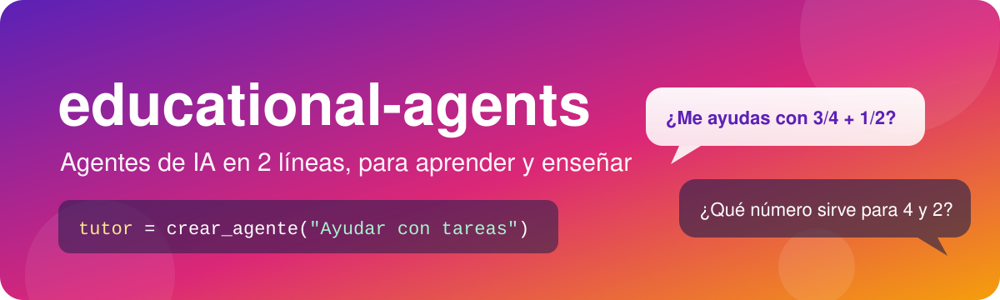
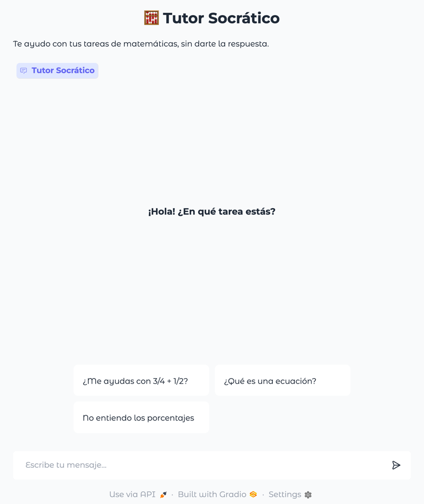
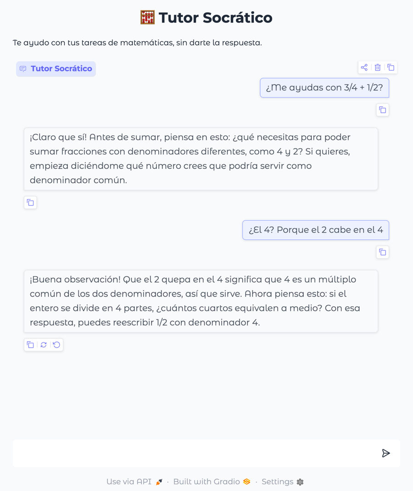
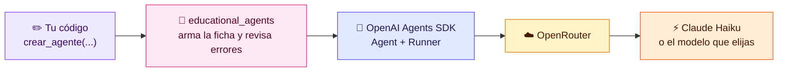

<p align="center">
  
</p>

<p align="center">
  <a href="https://colab.research.google.com/github/nifalconi/educational-agents/blob/main/ejemplos/ejemplo_curso.ipynb"></a>
  
  
  
  
  
  
</p>

<p align="center">
  <b>Una librería para enseñar qué es un agente de IA construyendo uno.</b><br>
  Sin configuración, en español y con errores que dicen cómo arreglarse.
</p>

---

```python
from educational_agents import crear_agente

tutor = crear_agente("Ayudar con tareas de matemáticas", nombre="Tutor")
tutor.chat("¿Me ayudas con 3/4 + 1/2?")
```

> [!NOTE]
> **Estado: prototipo (v0.1.0).** Probado con Python 3.12, openai-agents 0.24 y Gradio 6.31, fuera de Colab. Falta probarlo en un Colab real (ver [🗺️ Pendiente](#️-pendiente)).

## 📑 Contenido

| | | |
|---|---|---|
| 🎯 [Para qué existe](#-para-qué-existe) | 🚀 [Instalación](#-instalación) | ✨ [Uso rápido](#-uso-rápido) |
| 📚 [Guía por clase](#-guía-por-clase) | 🗣️ [Varios nombres](#️-varios-nombres-para-lo-mismo) | 🧠 [Qué lee el modelo](#-qué-lee-el-modelo-y-qué-no) |
| 🔀 [Cambiar el modelo](#-cambiar-el-modelo) | 🩹 [Cuando algo sale mal](#-cuando-algo-sale-mal) | 💡 [Ayuda en Colab](#-ayuda-dentro-de-colab) |
| 🏫 [Para profes](#-para-profes-y-tutoras) | 🛠️ [Desarrollo](#️-desarrollo) | 💜 [De dónde viene](#-de-dónde-viene) |

## 🎯 Para qué existe

La IA ya está en la vida diaria de las y los estudiantes: en el celular, en las tareas, en las redes. Pero casi siempre como una caja negra que responde. **`educational_agents` es para enseñar**: para que construyan su propio agente, le den una personalidad, herramientas, memoria y límites, y entiendan **por qué hace lo que hace**.

El problema es que, al enseñar, la configuración se come la clase. Cada notebook partía con unas 25 líneas que nadie venía a aprender, y era justo ahí donde todo fallaba:

<table>
<tr>
<th>😵 Antes: el setup de cada notebook (resumido)</th>
<th>😌 Ahora</th>
</tr>
<tr>
<td valign="top">

```python
!pip install openai-agents openai gradio
from google.colab import drive
drive.mount('/content/drive', force_remount=True)
import os
os.chdir('/content/drive/Shareddrives/...')

from openai import AsyncOpenAI
from agents import (Agent, Runner, ModelSettings,
    OpenAIChatCompletionsModel,
    set_default_openai_client, set_tracing_disabled)

client = AsyncOpenAI(
    base_url="https://openrouter.ai/api/v1",
    api_key="sk-or-...", max_retries=5)
set_default_openai_client(client)
set_tracing_disabled(True)
MODELO = OpenAIChatCompletionsModel(
    model="anthropic/claude-haiku-5.5",
    openai_client=client)
SETTINGS = ModelSettings(max_tokens=2048, extra_body=
    {"cache_control": {"type": "ephemeral"}})

agente = Agent(name="Tutor", model=MODELO,
    model_settings=SETTINGS,
    instructions="Ayudar con tareas")
resultado = await Runner.run(agente, "hola")
print(resultado.final_output)
```

</td>
<td valign="top">

```python
from educational_agents import crear_agente

tutor = crear_agente("Ayudar con tareas",
                     nombre="Tutor")
tutor.chat("hola")
```

</td>
</tr>
</table>

Lo que pasaba en los notebooks reales de un curso:

- 🔁 **Dos celdas de configuración con modelos distintos** en el mismo notebook. Quien las ejecutaba en orden quedaba con el modelo equivocado.
- 📁 **`drive.mount` + `os.chdir` con una ruta fija**, distinta en cada notebook. Sin acceso a esa carpeta, no corría nada.
- 🧩 **La plantilla de proyecto no corría tal cual:** definía `skills` pero usaba `habilidades`.
- ⏳ **`Runner.run` exige `await`**, y `Runner.run_sync` falla en Colab.
- 👥 **Gradio con `global memoria`:** al compartir el link se mezclaban las conversaciones de todas.

### Cómo está pensada

| | |
|---|---|
| 🎓 **Lo pedagógico manda** | El notebook muestra solo la idea de la clase. Lo demás vive en la librería. |
| 🧱 **Una clase, un parámetro** | Cada clase suma lo que enseñó (`tono=`, `herramientas=`, `memoria=True`…). Lo que todavía no se enseña viene apagado. |
| 🇨🇱 **En español** | Nombres, ayuda y errores en español de Latinoamérica. También acepta los nombres en inglés del SDK. |
| 🩹 **Errores que enseñan** | En una línea, al crear el agente (no a mitad de la conversación) y diciendo cómo se arregla. Nada falla en silencio. |
| 🔍 **Nada es magia** | `ver_pasos=True` muestra qué herramientas usó; `ver_instrucciones()`, el texto que lee el modelo. Por dentro es un `Agent` del [OpenAI Agents SDK](https://openai.github.io/openai-agents-python/), y `Runner.run(tutor, "hola")` sigue funcionando. |

## 🚀 Instalación

En Colab, la primera celda de cada notebook:

```python
#@title Preparación (ejecútala primero)
!pip install -q git+https://github.com/nifalconi/educational-agents
%env OPENROUTER_API_KEY=sk-or-...
```

- Instala `educational_agents`, `openai-agents` y `gradio`.
- La key es de [OpenRouter](https://openrouter.ai), que da acceso a muchos modelos con una sola key.
- Con `#@title`, Colab muestra la celda con un título y se puede ocultar el código. Más en [`docs/para-profes.md`](docs/para-profes.md).

> [!WARNING]
> Quien abra el notebook puede ver la key. Usa una con **límite de gasto** y rótala al terminar el curso. Nunca la subas a este repositorio.

En tu computador, para desarrollar:

```bash
git clone https://github.com/nifalconi/educational-agents
cd educational-agents
python3 -m venv .venv && source .venv/bin/activate
pip install -e ".[pruebas]"
pytest
```

## ✨ Uso rápido

```python
from educational_agents import crear_agente, herramienta, interfaz

# Crear el agente: solo las instrucciones son obligatorias
tutor = crear_agente(
    "Ayudar a estudiantes de secundaria con sus tareas.",
    nombre="Tutor Socrático",
    tono="Cercano y paciente. No das la respuesta: guías con preguntas.",
    audiencia="Estudiantes de 14 a 18 años.",
    limitaciones=["Solo temas escolares.", "No des la respuesta final."],
)

tutor.chat("¿Me ayudas con 3/4 + 1/2?")                  # conversa y muestra la respuesta
tutor.chat("¿Me ayudas con 3/4 + 1/2?", ver_pasos=True)  # además muestra qué hizo
respuesta = tutor.obtener_respuesta("hola")               # te entrega el texto para guardarlo
tutor.ver_instrucciones()                                 # el texto que lee el modelo
tutor.borrar_memoria()                                    # olvida la conversación

interfaz(tutor, ejemplos=["¿Cómo sumo fracciones?"])      # una página de chat para compartir
```

> [!TIP]
> El notebook [`ejemplos/ejemplo_curso.ipynb`](ejemplos/ejemplo_curso.ipynb) recorre todo, clase por clase. Se abre directo en Colab con el botón <a href="https://colab.research.google.com/github/nifalconi/educational-agents/blob/main/ejemplos/ejemplo_curso.ipynb"></a>

### 💬 Así se ve la interfaz

<table>
<tr>
<th>Al abrir el link</th>
<th>Conversando</th>
</tr>
<tr>
<td></td>
<td></td>
</tr>
</table>

Respuestas reales del modelo por defecto (Claude Haiku). El código que lo arma:

```python
tutor = crear_agente(
    "Ayudar a estudiantes de secundaria con sus tareas de matemáticas.",
    nombre="Tutor Socrático",
    tono="Cercano y paciente. No das la respuesta: guías con preguntas. Respuestas cortas, de 2 a 4 oraciones.",
    audiencia="Estudiantes de 14 a 18 años.",
    limitaciones=["Solo temas escolares.", "No des la respuesta final."],
    memoria=True,
)
interfaz(
    tutor,
    titulo="🧮 Tutor Socrático",
    descripcion="Te ayudo con tus tareas de matemáticas, sin darte la respuesta.",
    ejemplos=["¿Me ayudas con 3/4 + 1/2?", "¿Qué es una ecuación?", "No entiendo los porcentajes"],
    mensaje_inicial="¡Hola! ¿En qué tarea estás?",
)
```

### Cómo funciona por dentro



## 📚 Guía por clase

Un curso de 10 clases, del primer agente a la demo final. Es el orden del curso **IA Aplicada: Agentes** de [Niñas Pro](https://ninaspro.cl), pero sirve como mapa para cualquier curso o taller.

| Clase | Tema | Lo que se agrega |
|:---:|---|---|
| 2️⃣ | 👋 Primer agente | `crear_agente("instrucciones", nombre="...")` y `tutor.chat("hola")` |
| 3️⃣ | 🎭 Instrucciones y personalidad | `tono=`, `audiencia=`, `limitaciones=` y `tutor.ver_instrucciones()` |
| 4️⃣ | 🔧 Herramientas | `@herramienta` arriba de la función y `herramientas=[mi_funcion]` |
| 5️⃣ | 📖 Habilidades | `habilidades=["mi-habilidad"]` (carpeta `SKILLS/`) |
| 6️⃣ | 🧠 Memoria | `memoria=True`. La memoria en JSON la escriben ellas como herramientas |
| 7️⃣ | 🛡️ Guardrails | `guardrails_entrada=validar_entrada`, `guardrails_salida=validar_salida` |
| 8️⃣ | 🔍 Debugging | `tutor.chat("...", ver_pasos=True)` |
| 9️⃣ | 💬 Interfaz | `interfaz(tutor, titulo=, descripcion=, ejemplos=, mensaje_inicial=)` |
| 🔟 | 🎉 Integración | Todo junto. Opcional: dos agentes (`herramientas=[otro]`, `derivar_a=[otro]`) |

Código y explicación de cada clase: [`docs/guia-por-clase.md`](docs/guia-por-clase.md).

Así se ve `ver_pasos=True` (clases 4, 7 y 8):

```
🔧 calcular_tiempo({"horas_libres": 6, "materias": 3})
   📤 2.0 horas por materia

Tienes 2 horas para cada materia.
```
```
🛡️ validar_entrada bloqueó el mensaje

Eso está fuera de lo que puedo ayudarte.
```
```
🔀 pasó la conversación a Experta en becas

Soy la Experta en becas y te oriento sobre…
```

## 🗣️ Varios nombres para lo mismo

Cada parámetro se puede escribir de varias formas: **en inglés** (como en el OpenAI Agents SDK), **en español técnico** (el de las presentaciones) o **en español educativo**. Todas hacen lo mismo.

- 💡 La ayuda de Colab muestra el nombre **en negrita**, y en cada parámetro lista los demás: `tono (también: personalidad, tone)`.
- ✅ Todos se aceptan **con o sin tilde, con mayúsculas y en singular o plural**: `propósito`, `limitación`, `herramienta`, `Tono`.
- ⚠️ Si escribes dos nombres de lo mismo a la vez (`tono=` y `personalidad=`), sale un error que dice que dejes solo uno.

### `crear_agente(...)`

| 🇺🇸 Inglés | 🛠️ Español técnico | 🎓 Español educativo | ➕ Otros nombres |
|---|---|---|---|
| `instructions` ✓ | **`instrucciones`** | — | `proposito` |
| `name` ✓ | **`nombre`** | — | — |
| `handoff_description` ✓ | **`descripcion_para_agentes`** | `especialidad` | `cuando_usarme` |
| `tone` | **`tono`** | `personalidad` | — |
| `audience` | **`audiencia`** | `publico_objetivo` | — |
| `rules` | **`limitaciones`** | `reglas` | — |
| `tools` ✓ | **`herramientas`** | — | — |
| `skills` | **`habilidades`** | `recetas` | — |
| `skills_folder` | **`carpeta_habilidades`** | `carpeta_recetas` | — |
| `memory` | **`memoria`** | `recordar` | `memoria_de_sesion` |
| `input_guardrails` ✓* | **`guardrails_entrada`** | `filtro_entrada` | — |
| `output_guardrails` ✓* | **`guardrails_salida`** | `filtro_salida` | — |
| `handoffs` ✓ | **`derivar_a`** | `transferir_a` | — |
| `temperature` ✓ | **`temperatura`** | `creatividad` | `variedad` |
| `model` ✓ | **`modelo`** | — | — |

### Lo que se hace con el agente

| 🇺🇸 Inglés | 🛠️ Español técnico | 🎓 Español educativo | ➕ Otros nombres |
|---|---|---|---|
| `chat()` | **`chat()`** | `chat()` | — |
| `respond()` | **`obtener_respuesta()`** | `responder()` | — |
| `clear_memory()` | **`borrar_memoria()`** | `olvidar()` | — |
| `verbose=True` | **`ver_pasos=True`** | — | — |
| `show_instructions()` | **`ver_instrucciones()`** | — | — |
| `@function_tool` ✓ | **`@herramienta`** | — | — |

### `interfaz(...)`

| 🇺🇸 Inglés | 🛠️ Español técnico | 🎓 Español educativo | ➕ Otros nombres |
|---|---|---|---|
| `interface()` | **`interfaz()`** | `abrir_chat()` | — |
| `title` | **`titulo`** | — | — |
| `description` | **`descripcion`** | — | — |
| `examples` | **`ejemplos`** | — | — |
| `welcome` | **`mensaje_inicial`** | `bienvenida` | — |
| `theme` | **`tema`** | `colores` | — |
| `share` | **`compartir`** | — | — |

✓ Existe con ese nombre en el OpenAI Agents SDK (`temperature` va dentro de `ModelSettings`; `@function_tool` es su decorador). Los demás nombres en inglés no son del SDK: `Agent(tone=...)` no existe allá.

\* Mismo nombre que en el SDK, pero distinto formato. Aquí un guardrail es una función normal que recibe el texto y devuelve `(True, "")` si está todo bien o `(False, "mensaje")` si hay que bloquear. Si alguien pasa un guardrail hecho con `@input_guardrail` del SDK, sale un error que lo explica.

> [!CAUTION]
> **Ojo con algunas palabras**
> - **`reglas`** es otro nombre de `limitaciones` (texto que el modelo lee). Pero en una clase de guardrails, "implementa tres reglas" suele referirse a código. Si algo se tiene que bloquear siempre, va en `guardrails_entrada` o `guardrails_salida`.
> - **`memoria` / `recordar` y `borrar_memoria()` / `olvidar()`** son la memoria de la conversación. No tienen que ver con las herramientas que guardan datos en un JSON (`recordar_nombre`, `olvidar_dato`), que escriben las estudiantes.
> - **`creatividad`**: la temperatura no hace al modelo más creativo, hace sus respuestas más variadas (con 0 responde casi siempre igual). Por eso también existe `variedad`.

## 🧠 Qué lee el modelo y qué no

El `Agent` del SDK tiene **un solo campo de texto** (`instructions`) para todo lo que lee el modelo, y campos aparte para lo que hace el programa. `crear_agente` arma ese texto como una ficha de identidad:

```markdown
# Nombre
Tu nombre es Tutor Socrático. Es tu nombre como agente, no el de la persona que te escribe.

# Propósito
Ayudar a estudiantes de secundaria con sus tareas.

# Tono e identidad
Cercano y paciente. No das la respuesta: guías con preguntas.

# Audiencia
Estudiantes de 14 a 18 años.

# Limitaciones
- Solo temas escolares.
- No des la respuesta final.
```

| Parámetro | ¿Quién lo usa? |
|---|---|
| `instrucciones`, `tono`, `audiencia`, `limitaciones` | 📝 El modelo lo lee (va al texto de arriba) |
| `nombre` | 📝⚙️ Los dos: el modelo lo lee y el programa lo usa (título de la interfaz, nombre como herramienta) |
| `habilidades` | 📝⚙️ Los dos: el índice va al texto y los archivos se leen con herramientas |
| `descripcion_para_agentes` | 🤝 Lo leen **los otros agentes**, para saber cuándo llamar a este. El propio agente no la ve |
| `herramientas` | ⚙️ El programa. El modelo solo ve el nombre y el docstring de cada una |
| `memoria`, `guardrails_*`, `derivar_a`, `temperatura`, `modelo` | ⚙️ El programa. El modelo no los lee |

> [!IMPORTANT]
> **`limitaciones` y guardrails no son lo mismo.** Las limitaciones son reglas escritas que el modelo puede saltarse; un guardrail es código que bloquea siempre. Es una de las ideas centrales de una clase de IA responsable.

## 🔀 Cambiar el modelo

Por defecto, todos los agentes usan **Claude Haiku** (`anthropic/claude-haiku-5.5`) por OpenRouter: es rápido, barato y bueno usando herramientas. No hay que escribir nada.

Si quieres otro:

```python
from educational_agents import conectar, crear_agente

conectar(modelo="openai/gpt-4o-mini")                         # para todos los agentes nuevos
tutor = crear_agente("Ayudar", modelo="openai/gpt-4o-mini")   # solo para este agente
```

- 🗂️ Los nombres de los modelos están en [openrouter.ai/models](https://openrouter.ai/models).
- 🔌 **Otro proveedor** compatible con la API de OpenAI: `conectar(key="...", url="https://api.openai.com/v1", modelo="gpt-4o-mini")`. Solo está probado con OpenRouter.
- 🚫 Si el modelo no existe o la key no lo permite, el error lo dice y sugiere quitar `modelo=`.

## 🩹 Cuando algo sale mal

Los errores se muestran en una línea, en español, con la línea de la celda donde está el problema:

```
❌ (línea 2 de tu celda) crear_agente no tiene limitasiones=. ¿Quisiste decir limitaciones=?
```

| Lo que escribió | Lo que ve |
|---|---|
| `crear_agente("Tutor", "Ayudar…")` | Solo las instrucciones van sin nombre. Lo demás se escribe con su nombre… |
| `memoria="no"` | memoria tiene que ser True o False (sin comillas), no 'no'. |
| `herramientas=["calcular_tiempo"]` | En herramientas pusiste 'calcular_tiempo' entre comillas. Escríbela sin comillas… |
| `herramientas=[calcular_tiempo(6, 3)]` | En herramientas va el nombre de la función, sin (). |
| `tono="…", personalidad="…"` | Escribiste tono= y personalidad=, que son lo mismo. Deja solo uno. |
| `modelo="gpt-4"` (no permitido) | Ese modelo no existe o no está permitido con esta key. Revisa el nombre, o quita modelo=… |
| Habilidad mal escrita | No encontré la habilidad 'tutor-socratik' en SKILLS. ¿Quisiste decir 'tutor-socratico'? Las que hay son: … |
| Guardrail sin el `return` final | 'validar_entrada' no devolvió nada. ¿Te faltó el return True, "" del final? |
| `interfaz(tutor, tema="rosado")` | No existe el tema 'rosado'. Puedes usar: Citrus, Cyberpunk, Default, … |
| La key no sirve | No pude conectarme con el modelo: la key no funciona. Avísale a tu profe. |

También hay avisos ⚠️ que no detienen la celda: una herramienta sin docstring o sin tipos en sus parámetros, o una interfaz con un agente sin `memoria=True`.

## 💡 Ayuda dentro de Colab

La ayuda sale del código ya cargado: la celda de preparación tiene que haberse ejecutado antes.

- ⌨️ **Al escribir `crear_agente(`** o **pasar el mouse** sobre el nombre: la explicación de cada parámetro, con un ejemplo.
- ❓ **`crear_agente?`** abre la ayuda en un panel; **`help(educational_agents)`** muestra la tabla de nombres.
- ⇥ **`tutor.` + Tab** muestra los métodos (`chat`, `obtener_respuesta`, `borrar_memoria`, `ver_instrucciones`…). En Colab también aparecen algunos nombres del SDK, como `as_tool` o `clone`.
- 👀 Si una celda termina en `tutor`, se ve `<Agente 'Tutor'. Escríbele con .chat("hola")>`.

## 🏫 Para profes y tutoras

En [`docs/para-profes.md`](docs/para-profes.md): cómo armar la celda de preparación, la key, cómo elegir el modelo, cómo actualizar la librería, dónde poner las habilidades y los problemas más comunes.

> [!NOTE]
> **Qué no hace la librería, a propósito:** no escribe la memoria en JSON, no escribe los guardrails y no esconde las herramientas. Esas son las lecciones: las escriben las estudiantes. La librería solo las conecta con el agente.

## 🛠️ Desarrollo

```
src/educational_agents/__init__.py   lo que se importa y la ayuda de help(educational_agents)
src/educational_agents/agentes.py    todo el funcionamiento
docs/                                guía por clase, guía para profes y el banner
ejemplos/                            notebook de ejemplo para Colab
tests/                               pruebas sin conexión (pytest)
```

- 🧪 **Las pruebas no llaman al modelo** (usan una key falsa): `pytest`.
- ➕ **Para agregar un nombre nuevo** a un parámetro: súmalo en `_NOMBRES_AGENTE` (o `_NOMBRES_INTERFAZ`) en `agentes.py`, en el docstring de esa función, en la tabla de `__init__.py` y en este README. `tests/test_nombres.py` falla si falta en alguno de esos lugares, o si un nombre sirve para dos parámetros.

<details>
<summary><b>Detalles técnicos antes de tocar el código</b></summary>

- **asyncio:** Colab ya tiene un event loop corriendo, así que `Runner.run_sync` falla. Todo corre en un loop propio en un hilo aparte, y siempre el mismo, porque el cliente de OpenAI guarda conexiones atadas a su loop.
- **Gradio:** la memoria va por `request.session_hash`, una por persona que abre el link. En Gradio 6, el tema va en `launch()`.
- **Errores cortos:** `ErrorEnTuAgente` y `TypeError` se registran con `get_ipython().set_custom_exc(...)` al importar. Un `TypeError` por pasar un argumento sin nombre (`crear_agente("Tutor", "Ayudar")`) se traduce al español; cualquier otro se muestra con `shell.showtraceback()`, porque IPython ignora lo que devuelve el handler. `__tracebackhide__` solo no acorta los tracebacks.
- **Ayuda en Colab:** el recuadro muestra la línea del `def` tal como está escrita (no usa `__signature__`), así que los nombres principales van como parámetros reales, en el orden en que se enseñan, y los otros nombres entran por `**otros_nombres`. El docstring se lee como markdown, pero solo en parte: funcionan los bloques ` ```python `, los títulos `###`, las listas y el `código`; las negritas y cursivas salen con los asteriscos. `tests/test_nombres.py` revisa que no haya `**` en la ayuda.
- **Caché:** `cache_control` solo se pide a modelos de Anthropic; otros proveedores podrían rechazarlo.

</details>

## 🗺️ Pendiente

- [ ] Probarlo en un Colab real: la instalación, la ayuda al pasar el mouse y el error en una línea.
- [ ] Decidir cómo llega la key (Secretos de Colab, una casilla o dentro de la librería).
- [ ] Probar `modelo=` con una key que permita otros modelos (hoy solo está probado el error cuando no lo permite).

## 💜 De dónde viene

Nació en el curso **IA Aplicada: Agentes** de [Niñas Pro](https://ninaspro.cl), que da cursos de programación, robótica e IA para niñas en Chile. Los ejemplos, el orden de las clases y los errores que maneja salen de los notebooks y de las dudas reales de ese curso.
